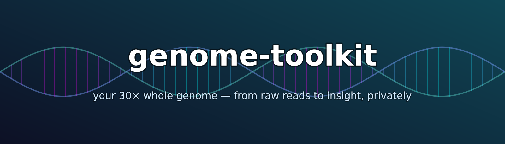

# genome-toolkit


**Your whole-genome sequencing is a giant file of raw DNA letters — basically
unreadable on its own. This toolkit turns it into plain-English reports you can
actually use, and lets you _ask an AI assistant questions about your own genome_.
Everything runs on your computer; your DNA never leaves it.**

Curious whether caffeine actually keeps you up, why a medication did nothing for
you, or whether you carry something worth mentioning to your doctor? Your genome
already has answers. This turns them into reports you can read — and lets you
just ask:

```
You:   "Any genetic reason a normal dose of clopidogrel might not work for me?"
Agent: (checks your genome) "Yes — you process it poorly (a CYP2C19 'intermediate
        metabolizer'), so it may be less effective. Many guidelines prefer
        prasugrel or ticagrelor instead. Worth raising with your doctor."
```

Under the hood it's a set of small, simple scripts (you run them one at a time)
that work with whole-genome sequencing from **any provider** and rebuild the
whole analysis from scratch on any Mac or Linux computer.

> ### 🔒 Privacy is the whole point
> This repository contains **only code**. No DNA, no results, ever. A broad
> [`.gitignore`](.gitignore) *and* an independent
> [pre-commit guard](.githooks/pre-commit) make sure of it. You point the scripts
> at your own files; every result stays in a local `analysis/` folder that's
> never shared. The AI connection runs locally too, with no open network port.
> **Your genome never leaves your machine.**

---

## ✅ Do I have the right kind of data?

You need **whole-genome sequencing (WGS)** — your genome actually read letter by
letter. Any one of these files works (more of them = more you can do):

| You have… | It looks like | Lets you run |
|---|---|---|
| A **VCF** file (the list of spots where your DNA differs from the standard human reference) | `*.vcf.gz` (tens–hundreds of MB) | the **main reports** (quality, traits, drug response, health-variant screen) |
| **FASTQ** (the rawest form — unassembled DNA letters straight off the sequencer) | `*_R1*.fastq.gz` + `*_R2*` (many GB) | everything, including the advanced "second-pass" callers |
| A **BAM / CRAM** (your reads already lined up against the reference) | `*.bam` / `*.cram` (many GB) | the advanced second-pass callers |

It works with files from any provider that lets you **download your own data** —
e.g. Sequencing.com, Dante Labs, Nucleus, ySeq, a research/clinical lab, or your
own pipeline. The scripts figure out your file names automatically.

> ### ❌ What does *not* work: 23andMe / AncestryDNA / MyHeritage
> Those "raw data" downloads come from a **genotyping chip**, which only reads
> about 600,000 hand-picked spots — **less than 0.1% of your genome** — and saves
> them in a tiny text file. That's not sequencing, can't be turned into it, and
> this toolkit can't use it. Quick rule: **sequencing files are gigabytes;
> chip/array files are megabytes.**

<details>
<summary>The fine print on data quality & reference version (optional reading)</summary>

> **How deep was your sequencing?** "Depth" (written like "30×") is how many
> times each spot in your genome was read. The main reports run fine from any
> reasonable WGS file, but the advanced second-pass callers really want ~30×
> (treat anything below ~20× as unreliable), and very cheap "low-pass" sequencing
> is shakier on rare findings.
>
> **Which reference version?** Everyone lines their DNA up against a shared
> "reference genome," and there are two editions in common use: the current one,
> **GRCh38** (a.k.a. hg38), and the older **GRCh37** (a.k.a. hg19). They number
> positions differently. Most genome data from ~2020 onward is GRCh38, which is
> what the health-variant screen and the second-pass callers assume. The trait
> and drug-response reports look things up by a stable ID (an "rsID," like
> `rs429358`) and work on either version. The toolkit detects and tells you which
> version you have.
</details>

---

## What you get

| Report | What it tells you |
|---|---|
| **Data check** | is your file healthy and complete? basic quality numbers + your genetic sex |
| **Traits** | the genetics behind everyday things — caffeine, lactose tolerance, APOE (Alzheimer's), MTHFR… |
| **Drug-response card** | how your body is predicted to handle common medications — pharmacist-ready |
| **Health-variant screen** | variants you carry that are listed in **ClinVar** (a public database of DNA changes doctors have linked to conditions), ranked by how well-established each is |
| **Look up anything** | your DNA at any gene, position, or known variant, on demand |

Example — the drug-response card *(illustrative format, not real data)*. A
"metabolizer" status is just how fast your body processes a drug, which can
change the right dose:

```
| Gene    | Your version | Predicted effect          | Drugs it affects       |
|---------|--------------|---------------------------|------------------------|
| CYP2C19 | *1/*2        | Intermediate metabolizer  | clopidogrel, some SSRIs|
| DPYD    | *1/*1        | Normal                    | fluorouracil (safe)    |
| SLCO1B1 | *1/*1        | Normal                    | simvastatin (safe)     |
```

---

## Quick start

```bash
# 0. tell the scripts where your data is (the folder with your VCF / FASTQ)
export DATA_DIR=/path/to/your/genome

# 1. install the basic tools (via Homebrew or conda)
scripts/00_install_tools.sh

# 2. turn on the privacy guard, so you can never accidentally share your DNA
scripts/install_git_hooks.sh

# 3. run the main analysis (takes minutes, from your VCF)
scripts/run_all.sh
```

Everything generated goes to `analysis/`, which is kept private. If the scripts
can't find your file, they'll list what they *did* see and tell you exactly what
to set.

### 🤖 Or just hand this whole folder to your AI agent

The easiest path: open this folder in **Claude Code** (or Cursor, or any
AI-coding assistant) and paste something like:

> *I have whole-genome sequencing data in `/path/to/my/genome`. Set up this
> genome-toolkit for me: install the tools, run the analysis on my data, and
> start the server so I can ask you questions about my genome. Let me know if you
> need anything.*

The assistant has everything it needs — the scripts find your files, keep
results local, and print the exact config to connect. From then on you can just
ask it about your genome in plain English.

---

## Going deeper

<details>
<summary><b>The scripts</b> — what each one does</summary>

```
scripts/
├── 00_install_tools.sh      install the analysis tools (+ optional --align / --callers)
├── 01_inspect.sh            describe every input file you have
├── 02_index_vcfs.sh         prepare your files for fast lookups
├── 03_extract_variants.sh   pull your variants into a compact working file
├── 04_vcf_stats.sh          quality numbers + inferred sex
├── 05_genotype_lookup.sh    look up your DNA by gene / position / variant
├── 06_trait_report.sh       your genotype at well-known trait variants
├── 07_pgx_report.sh         the drug-response card
├── 10_align_from_fastq.sh   FROM RAW READS: FASTQ → aligned genome (hours)
│   ── second pass: advanced callers that need the aligned reads ──
├── 11_cyp2d6.sh             CYP2D6 (a major drug-processing gene)  (Cyrius)
├── 13_hla.sh                HLA drug-allergy risk alleles  (T1K)
├── 14_repeats.sh            repeat-expansion disorders  (ExpansionHunter)
├── 15_smn.sh                SMA carrier status  (SMNCopyNumberCaller)
├── 16_gba.sh                GBA — Gaucher / Parkinson's risk  (Gauchian)
├── 17_mtdna.sh              maternal-line ancestry + a hearing-loss drug gene  (Haplogrep)
├── 20_clinvar_annotate.sh   full ClinVar health-variant screen
├── 50_serve_mcp.sh          serve your results to an AI assistant
├── run_all.sh               the main analysis chain (steps 01→07)
├── install_git_hooks.sh     turn on the privacy guard
└── lib/common.sh            shared settings + auto-detection of your files
```

Look up anything on demand:

```bash
scripts/05_genotype_lookup.sh rs429358            # APOE — Alzheimer's
scripts/05_genotype_lookup.sh rs1801133 rs671     # MTHFR + alcohol flush
```
</details>

<details>
<summary><b>Re-build from the raw reads</b> (optional, heavy — needs FASTQ)</summary>

The main analysis works from your variant file. If you have the **raw reads**
(FASTQ), you can rebuild the alignment from scratch — to double-check your
provider's work, measure true sequencing depth, or unlock the second pass. One
command (downloads the reference, several hours, ~80 GB of scratch space; it
automatically uses a memory-light aligner on smaller machines so it won't run out
of memory):

```bash
scripts/00_install_tools.sh --align
scripts/10_align_from_fastq.sh
```
</details>

<details>
<summary><b>Second pass:</b> the genes a normal analysis can't read</summary>

A few of the most important genes are genuinely hard to read: some sit next to a
near-identical "decoy" copy that confuses the software, some vary in how many
copies you have, and some involve a short DNA pattern that repeats many times
(too many repeats causes certain diseases). A normal analysis gives up or guesses
on these. The classic example is **CYP2D6** (codeine, tamoxifen, many
antidepressants), which usually comes back "can't tell." With the aligned reads
(from your FASTQ, ~30× and GRCh38), purpose-built tools resolve them:

```bash
scripts/00_install_tools.sh --callers
scripts/11_cyp2d6.sh    # CYP2D6 — a major drug-processing gene
scripts/13_hla.sh       # HLA — severe drug-allergy risk (abacavir, carbamazepine…)
scripts/14_repeats.sh   # Huntington, ALS/FTD, Fragile-X, ataxias…
scripts/15_smn.sh       # spinal muscular atrophy (SMA) carrier status
scripts/16_gba.sh       # GBA — Gaucher disease / Parkinson's risk
scripts/17_mtdna.sh     # maternal-line ancestry + a hearing-loss drug gene
scripts/50_serve_mcp.sh --rebuild        # refresh what your AI assistant sees
```

Each writes a small result file the toolkit folds into your reports. Full detail
in [`docs/SECOND_PASS.md`](docs/SECOND_PASS.md).
</details>

---

## Ask your AI assistant about your genome

Turn your results into a private knowledge source any AI assistant can use, over
a standard called **MCP** ([Model Context Protocol](https://modelcontextprotocol.io)) —
works with Claude Desktop, Claude Code, Cursor, and others:

```bash
scripts/50_serve_mcp.sh        # builds your results + prints the exact config to paste in
```

It runs locally as a small helper your assistant talks to directly — **no network
port, nothing leaves your machine**. Your assistant can then answer things like
*"any genetic concern with clopidogrel?"* or *"what's my APOE status?"* by looking
at your actual genome. Setup + per-app config in [`mcp/README.md`](mcp/README.md).
To run it always-on for access from your phone or another computer (over a private
[Tailscale](https://tailscale.com) network), see [`docs/DEPLOY.md`](docs/DEPLOY.md).

---

## Requirements

- **macOS or Linux**, and either **Homebrew** or **conda** to install the tools.
- The main analysis runs on a laptop and needs only a few small tools.
- Rebuilding from raw reads adds a bigger toolset and ~80 GB of free space
  (a roomy external drive works — just point the output there).
- The advanced second-pass callers need ~30× reads on the GRCh38 reference.
- Public reference data is downloaded as needed and never stored in this repo.

## How privacy is enforced

1. **`.gitignore`** blocks every DNA / variant / alignment file type, the results
   folders, and anything carrying your name or sample id.
2. **`.githooks/pre-commit`** independently refuses to commit anything that even
   *looks* like genetic data. Turn it on with `scripts/install_git_hooks.sh`.
3. The only data in this repo is **public reference knowledge** (lookup tables for
   traits, drug genes, and disorders) — never anyone's actual genotype.

Check at any time that nothing personal slipped in:

```bash
git ls-files | grep -Ei '\.(vcf|fq|fastq|bam|cram|gvcf)(\.gz)?$' || echo "clean ✓"
```

---

## ⚠️ Disclaimer

For **personal education and curiosity only** — **not medical advice**, not a
diagnosis. Everything here is *predicted from consumer-grade sequencing*, not done
in a certified clinical lab, and individual results can be wrong. Talk to a
doctor, pharmacist, or genetic counselor — and confirm anything important in a
certified lab — before acting on it.

## License

[MIT](LICENSE) — the scripts are yours to use and adapt. Your genome is yours alone.
